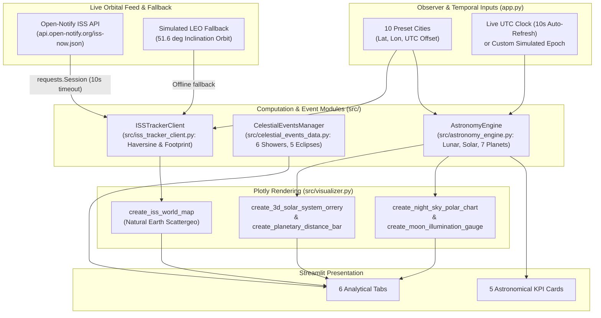

<h1 align="center">🪐 Celestial Ephemeris, Lunar Cycles &amp; Orbital Mechanics Platform</h1>

<p align="center">
  <strong>Computational astronomy and real-time orbital telemetry dashboard built with Streamlit and Plotly — computing Julian Date lunar phases, solar twilight &amp; golden-hour schedules, 7-planet ephemeris, a 3D Solar System orrery, polar night-sky radar, meteor/eclipse calendars, and live International Space Station (ISS) tracking.</strong>
</p>

<p align="center">
  <a href="#-executive-overview--observatory-capabilities"><b>Overview &amp; Observatories</b></a> •
  <a href="#-dashboard-modules--core-engines"><b>Modules &amp; Engines</b></a> •
  <a href="#-astronomical-algorithms--equations"><b>Astronomical Equations</b></a> •
  <a href="#-system-architecture"><b>Architecture</b></a> •
  <a href="#-repository-structure"><b>Structure</b></a> •
  <a href="#-installation--usage"><b>Installation &amp; Usage</b></a> •
  <a href="#-data-feeds-disclaimers--license"><b>Data &amp; License</b></a>
</p>

<p align="center">
  
  =1.35.0" />
  =5.18.0" />
  
</p>

<p align="center">
  
  
  
  
</p>

---

## 🎯 Executive Overview & Observatory Capabilities

The **Celestial Ephemeris, Lunar Cycles & Orbital Mechanics Platform** (`app.py`) delivers real-time astronomical calculations and interactive 2D/3D sky visualizations from any of **10 preset global observatories** — **Casablanca**, **Marrakech**, **Riyadh**, **Dubai**, **Cairo**, **Paris**, **London**, **Tokyo**, **New York**, and **Sydney** — in either live 10-second auto-refresh UTC mode or custom simulated date/time mode.

### Core Astronomical Coverage

| Domain | Scope & Parameters (`src/astronomy_engine.py`, `src/celestial_events_data.py`, `src/iss_tracker_client.py`) |
|---|---|
| **Lunar Cycles** | 8 synodic phases, lunar age (`0–29.53 days`), illumination `%`, perigee/apogee distance (`km`), Supermoon/Micromoon classification, light travel time (`s`), and next Full/New Moon dates. |
| **Solar & Twilights** | Official Sunrise/Sunset ($90.833^\circ$), Solar Noon, Daylight Length, Solar Declination, Civil ($96^\circ$), Nautical ($102^\circ$), and Astronomical ($108^\circ$) twilights, plus Evening Golden and Blue Hours. |
| **7-Planet Ephemeris** | Mercury, Venus, Mars, Jupiter, Saturn, Uranus, and Neptune — geocentric distance (`AU` and Million `km`), light travel time (`min`), apparent magnitude, altitude/azimuth, and naked-eye vs. telescope status. |
| **Celestial Events** | **6** major annual meteor showers (Perseids, Geminids, Quadrantids, Eta Aquariids, Orionids, Lyrids) and **5** total solar & lunar eclipses across `2026–2028` (`ECLIPSES_CALENDAR`). |
| **Live ISS Tracking** | Real-time latitude/longitude from `api.open-notify.org/iss-now.json`, LEO metrics (`420 km` altitude, `27,600 km/h`), observer Haversine distance, and `<= 2,200 km` overhead horizon check. |

---

## 🧩 Dashboard Modules & Core Engines

The dashboard displays 5 top-level KPI metric cards (`Current Moon Phase`, `Lunar Illumination`, `Earth-Moon Distance`, `Naked-Eye Planets`, `Daylight Length`) above **6 interactive tabs**:

| Dashboard Tab | Core Module & Functions | Visualizations & Outputs |
|---|---|---|
| **🌙 Moon Phases & Lunar Intelligence** | `AstronomyEngine.calculate_moon_phase()` (`src/astronomy_engine.py`) + `create_moon_illumination_gauge()` (`src/visualizer.py`) | Phase dossier card, illumination gauge (`0–100%`), Earth-Moon distance status, light travel time, upcoming Full/New Moon dates, and an expandable synodic cycle reference table. |
| **🪐 Planets & Solar System Ephemeris** | `AstronomyEngine.calculate_planetary_ephemeris()` + `create_planetary_distance_bar()` | Tabular telemetry for all 7 planets (`PLANETS_ORBITAL_DATA`) paired with a color-coded horizontal distance comparison bar chart (Million `km`). |
| **☀️ Sun, Twilight & Golden Hours** | `AstronomyEngine.calculate_sun_and_twilight()` | 3-column breakdown of Sunrise/Solar Noon/Sunset, solar declination, Civil/Nautical/Astronomical twilight boundaries, and evening Golden/Blue Hour photography windows. |
| **🌌 3D Solar System & Stargazing Sky Chart** | `create_3d_solar_system_orrery()` & `create_night_sky_polar_chart()` (`src/visualizer.py`) | Interactive 3D Plotly `Scatter3d` Solar System orrery (with $r^{0.6} \times 4.0$ scaled orbits) and a 2D zenith-centered polar sky chart (`90°` zenith to `0°` horizon) for the Moon and above-horizon planets. |
| **☄️ Meteor Showers & Eclipses Calendar** | `CelestialEventsManager.get_meteor_showers_df()` & `get_eclipses_df()` (`src/celestial_events_data.py`) | Dual sub-tabs covering peak dates, activity windows, ZHR, radiants, and parent bodies for meteor showers alongside totality durations and geographic paths for 2026–2028 eclipses. |
| **🛰️ Live ISS & Space Station Tracker** | `ISSTrackerClient.fetch_live_iss_position()` (`src/iss_tracker_client.py`) + `create_iss_world_map()` | Live telemetry metrics (`Altitude`, `Velocity`, `Distance to Observer`, `Orbital Period = 92.68 min`) plotted on a Natural Earth `go.Scattergeo` map with observer pin. |

---

## 🧮 Astronomical Algorithms & Equations

### 1. Julian Date Conversion (`datetime_to_julian_date`)

For UTC year $y$, month $m$, and fractional day $D$: if $m \le 2$, set $Y = y - 1$ and $M = m + 12$; otherwise $Y = y, M = m$. Then:

$$A = \left\lfloor \frac{Y}{100} \right\rfloor, \qquad B = 2 - A + \left\lfloor \frac{A}{4} \right\rfloor$$

$$\text{JD} = \lfloor 365.25(Y + 4716) \rfloor + \lfloor 30.6001(M + 1) \rfloor + D + B - 1524.5$$

### 2. Lunar Synodic & Anomalistic Mechanics (`calculate_moon_phase`)

Anchored to reference New Moon $\text{JD}_0 = 2451549.7597$ (`2000-01-06 18:14 UTC`) with synodic month $T_s = 29.530588853\text{ d}$, anomalistic month $T_a = 27.55454988\text{ d}$, and $\Delta t = \text{JD} - \text{JD}_0$:

$$\theta_{\text{phase}} = 2\pi \left(\frac{\Delta t \bmod T_s}{T_s}\right), \qquad \text{Illumination (\%)} = 100 \cdot \frac{1 - \cos\theta_{\text{phase}}}{2}$$

$$d_{\text{Moon}} = 384{,}400 - 20{,}905 \cos\!\left(2\pi \frac{\Delta t \bmod T_a}{T_a}\right)\text{ km}, \qquad t_{\text{light}} = \frac{d_{\text{Moon}}}{299{,}792.458}\text{ s}$$

Properties classify Perigee Supermoons at $d_{\text{Moon}} < 360{,}000\text{ km}$ and Apogee Micromoons at $d_{\text{Moon}} > 404{,}000\text{ km}$.

### 3. Solar Ephemeris & Twilight Hour Angles (`calculate_sun_and_twilight`)

Given day-of-year $\text{doy}$, observer latitude $\phi$, longitude $\lambda$, timezone offset $\Delta t_{\text{TZ}}$, and $B = \frac{360^\circ}{365}(\text{doy} - 81)$:

$$\delta = 23.45^\circ \sin(B), \qquad \text{EoT} = 9.87\sin(2B) - 7.53\cos(B) - 1.5\sin(B)\text{ min}$$

$$\text{Solar Noon} = 12.0 - \frac{\lambda}{15} - \frac{\text{EoT}}{60} + \Delta t_{\text{TZ}}, \qquad H(z) = \frac{1}{15} \arccos\!\left(\frac{\cos z - \sin\phi\sin\delta}{\cos\phi\cos\delta}\right)$$

Evaluated at solar zenith angles $z = 90.833^\circ$ (Sunrise/Sunset), $96^\circ$ (Civil), $102^\circ$ (Nautical), and $108^\circ$ (Astronomical).

### 4. Planetary Positions, Pogson Magnitude & ISS Haversine Distance

With Julian centuries since J2000.0 $T = (\text{JD} - 2451545.0)/36525.0$, circular coplanar planet vectors $(x_p, y_p)$ from semi-major axis $a$ and mean longitude $\lambda_p$, and Earth radius $r_\oplus = 1.000001018(1 - 0.0167086\cos M_\oplus)$:

$$\Delta_{\text{AU}} = \sqrt{(x_p - x_\oplus)^2 + (y_p - y_\oplus)^2}, \qquad m = V_0 + 5\log_{10}\!\big(\max(0.1,\; a \cdot \Delta_{\text{AU}})\big)$$

Ground distance between observer $(\phi_1, \lambda_1)$ and ISS $(\phi_2, \lambda_2)$ uses Earth radius $R_\oplus = 6371.0\text{ km}$:

$$d = 2 R_\oplus \operatorname{atan2}\!\left(\sqrt{a},\, \sqrt{1-a}\right), \qquad a = \sin^2\!\left(\frac{\Delta\phi}{2}\right) + \cos\phi_1\cos\phi_2\sin^2\!\left(\frac{\Delta\lambda}{2}\right)$$

---

## 🏗️ System Architecture



---

## 📂 Repository Structure

```text
celestial-ephemeris-platform/
├── src/
│   ├── __init__.py                   # Package marker
│   ├── astronomy_engine.py           # Julian Date, Lunar phase, Solar/twilight & 7-planet ephemeris
│   ├── celestial_events_data.py      # Curated meteor showers & 2026-2028 solar/lunar eclipses
│   ├── iss_tracker_client.py         # Open-Notify ISS API client, Haversine distance & fallback orbit
│   └── visualizer.py                 # 3D Solar System orrery, polar sky radar, gauges & ISS map
├── app.py                            # Main Streamlit dashboard entrypoint (6 tabs + 10s refresh)
├── requirements.txt                  # Python dependencies
├── LICENSE                           # Apache License 2.0
├── .gitattributes                    # Git text/EOL attributes
└── .gitignore                        # Python/venv/env ignore rules
```

---

## 🚀 Installation & Usage

### Prerequisites

- **Python**: `3.10+`
- **Dependencies** (`requirements.txt`): `streamlit>=1.35.0`, `pandas>=2.0.0`, `numpy>=1.24.0`, `requests>=2.31.0`, `plotly>=5.18.0`, `scipy>=1.11.0`, `streamlit-autorefresh>=1.0.1`
- No API keys or `.env` configuration are required.

### 1. Clone the Repository

```bash
git clone https://github.com/khalid-naami/celestial-ephemeris-platform.git
cd celestial-ephemeris-platform
```

### 2. Create Virtual Environment & Install Dependencies

**Windows (PowerShell):**

```powershell
python -m venv .venv
.\.venv\Scripts\Activate.ps1
pip install -r requirements.txt
```

**macOS / Linux:**

```bash
python3 -m venv .venv
source .venv/bin/activate
pip install -r requirements.txt
```

### 3. Launch the Dashboard

```bash
streamlit run app.py
```

---

## 🌐 Data Feeds, Disclaimers & License

### External Data Feeds

- **Open-Notify ISS Now API**: `http://api.open-notify.org/iss-now.json` queried via `requests.Session` in `src/iss_tracker_client.py`.

### Computational Notice

- The astronomical calculations in `src/astronomy_engine.py` implement lightweight analytical approximations (circular coplanar mean-longitude planetary orbits, first-order solar declination/EoT equations, and modeled sky altitude/azimuth projections) intended for interactive visualization and educational exploration rather than sub-arcsecond astrometric navigation or telescope pointing.
- When the Open-Notify API is unreachable or rate-limited, `ISSTrackerClient` switches to a sinusoidal orbital simulation (`51.6°` inclination) labeled as simulated trajectory telemetry in the UI.

### License

Distributed under the **Apache License 2.0**. See [`LICENSE`](LICENSE) for full terms.
